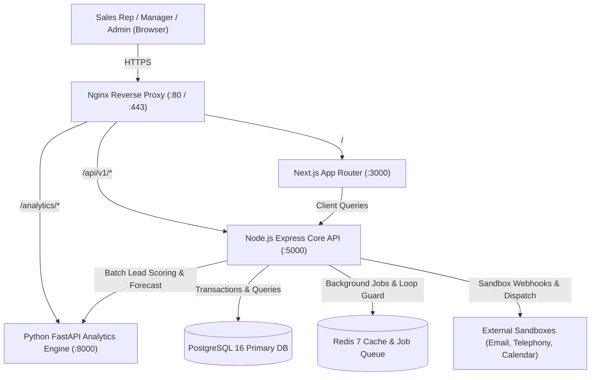

# ClientSphere (Project 06)
> **Enterprise CRM, Sales Pipeline & Workflow Automation Platform**  
> *Technical Skills Evaluation Cohort | Version 1.0 | Prepared for Orion LMS*

[](.github/workflows/ci.yml)
[](server/tests)
[](services/analytics/tests)
[]()
[](docs/assessments/assessment_handbook.md)

---

## 1. Executive Summary & Capabilities
ClientSphere is an enterprise-grade CRM engineered to handle multi-tenant sales operations, complex B2B entity relationships, high-velocity pipelines, predictive sales forecasting, and resilient workflow automation.

### Key Highlights:
1. **Multi-Service Architecture**: Next.js 14 App Router UI, secure Node.js/Express core business API, and Python FastAPI analytics engine.
2. **Domain-Specific Capstone Solved**:
   - **Many-to-Many Contacts & Companies**: Contacts can hold distinct roles across multiple companies simultaneously (`company_contacts`), complete with primary designations.
   - **Multi-Rep Opportunity Collaboration**: Opportunity teams allow multiple representatives to collaborate with granular permissions (READ/WRITE/ADMIN) and commission split percentages.
3. **Optimistic Concurrency Control**: Guarantees zero lost updates during concurrent opportunity edits via integer `version` verification (`409 CONCURRENT_MODIFICATION_ERROR`).
4. **Resilient Workflow Automation**: Configurable trigger-condition-action engine equipped with recursive loop detection (`ABORTED_LOOP` when depth > 5).
5. **AI Lead Processing & Sales Velocity**: Python FastAPI service providing Levenshtein fuzzy deduplication, explainable factor scoring, and sales velocity metrics ($V = \frac{N \times S \times W}{T}$).

---

## 2. Technology Stack & Service Boundaries

| Layer | Technology | Service Ownership & Responsibility |
| :--- | :--- | :--- |
| **Frontend** | React, Next.js 14 App Router, TypeScript, Tailwind CSS, TanStack React Query | Visual presentation, Kanban board, timeline, profile wizards, client-side caching. |
| **Core API** | Node.js, Express.js, REST, TypeScript, Zod, JWT/Bcrypt | Authoritative customer records, RBAC authorization, transaction boundaries, audit logs. |
| **Intelligence** | Python 3, FastAPI, Pydantic, RapidFuzz/Levenshtein, Pytest | CSV normalization, fuzzy deduplication, lead scoring heuristics, sales velocity, forecast math. |
| **Database** | PostgreSQL 16 (Relational DB & SQL migrations) | Relational integrity, foreign keys, cascade deletes, GIN indexes, dedup indexes. |
| **Cache & Queue** | Redis 7 & BullMQ | Async job dispatch, rate limit tracking, automation recursion guards. |
| **Reverse Proxy** | Nginx | SSL/TLS termination, rate limiting, request forwarding, security headers. |

---

## 3. Architecture & Dataflow



Full architecture specifications and ER diagrams are available in [`docs/ARCHITECTURE.md`](file:///c:/Users/prakh/OneDrive/Desktop/ClientSphere/docs/ARCHITECTURE.md).

---

## 4. Mandatory Assessments Checklist (15/15 Delivered)

| Assessment | Title | Delivered Capabilities | Verification Link |
| :---: | :--- | :--- | :--- |
| **01** | **CRM Frontend** | Kanban board, lead/contact/deal profiles, activity timeline, CSV import wizard. | [`client/src/app/`](file:///c:/Users/prakh/OneDrive/Desktop/ClientSphere/client/src/app/) |
| **02** | **CRM Backend APIs** | Modular REST APIs, validation, pagination, consistent errors, request IDs. | [`server/src/modules/`](file:///c:/Users/prakh/OneDrive/Desktop/ClientSphere/server/src/modules/) |
| **03** | **Relational Model** | Many-to-many join tables, foreign key constraints, indexes, migrations. | [`server/prisma/schema.prisma`](file:///c:/Users/prakh/OneDrive/Desktop/ClientSphere/server/prisma/schema.prisma) |
| **04** | **Access Control** | JWT rotation, RBAC (5 roles), record visibility checks, sensitive data masking. | [`server/src/middleware/auth.ts`](file:///c:/Users/prakh/OneDrive/Desktop/ClientSphere/server/src/middleware/auth.ts) |
| **05** | **Python Lead Processing** | CSV import normalization, Levenshtein fuzzy dedup, explainable scoring. | [`services/analytics/`](file:///c:/Users/prakh/OneDrive/Desktop/ClientSphere/services/analytics/) |
| **06** | **FastAPI Sales Intelligence** | Sales velocity, 3-tier forecast (Commit, Best Case, Weighted), conversion funnel. | [`services/analytics/app/routers/sales_intelligence.py`](file:///c:/Users/prakh/OneDrive/Desktop/ClientSphere/services/analytics/app/routers/sales_intelligence.py) |
| **07** | **Workflow Automation** | Triggers, multi-condition evaluation, action dispatch, infinite loop depth check. | [`server/src/modules/automation/`](file:///c:/Users/prakh/OneDrive/Desktop/ClientSphere/server/src/modules/automation/) |
| **08** | **External Integrations** | Email sandbox, calendar scheduler, telephony HMAC signature webhook. | [`server/src/modules/integrations/`](file:///c:/Users/prakh/OneDrive/Desktop/ClientSphere/server/src/modules/integrations/) |
| **09** | **Docker CRM Stack** | Multi-stage Dockerfiles, Docker Compose, health checks, persistent volumes. | [`docker-compose.yml`](file:///c:/Users/prakh/OneDrive/Desktop/ClientSphere/docker-compose.yml) |
| **10** | **Git Collaboration** | Feature branches, PR templates, CODEOWNERS, reviewed migrations policy. | [`.github/`](file:///c:/Users/prakh/OneDrive/Desktop/ClientSphere/.github/) |
| **11** | **CRM CI/CD** | Automated GitHub Actions workflow testing Node, Python, and Docker builds. | [`.github/workflows/ci.yml`](file:///c:/Users/prakh/OneDrive/Desktop/ClientSphere/.github/workflows/ci.yml) |
| **12** | **Test Strategy** | 28 automated tests covering duplicate rejection, OCC, team access, and loops. | [`server/tests/`](file:///c:/Users/prakh/OneDrive/Desktop/ClientSphere/server/tests/) |
| **13** | **API Documentation** | OpenAPI 3.0 specification (`openapi.yaml`) & Postman Collection. | [`docs/openapi.yaml`](file:///c:/Users/prakh/OneDrive/Desktop/ClientSphere/docs/openapi.yaml) |
| **14** | **Production Deployment** | Nginx reverse proxy, security headers, rate limiting, private networks. | [`docker-compose.prod.yml`](file:///c:/Users/prakh/OneDrive/Desktop/ClientSphere/docker-compose.prod.yml) |
| **15** | **Incident Simulation** | 5 detailed Root Cause Analyses with reproduction scripts & regression tests. | [`docs/incidents/`](file:///c:/Users/prakh/OneDrive/Desktop/ClientSphere/docs/incidents/) |
| **CAP** | **Capstone Challenge** | Contacts associated with multiple companies + multi-rep deal collaboration. | [`server/tests/relationships_capstone.test.ts`](file:///c:/Users/prakh/OneDrive/Desktop/ClientSphere/server/tests/relationships_capstone.test.ts) |

---

## 5. Local Setup & Running Instructions

### Prerequisites
- Node.js >= 20.x
- Python >= 3.11.x
- Docker & Docker Compose (Optional for containerized run)

### 5.1 Running with Docker Compose (Recommended)
```bash
# Clone the repository
git clone https://github.com/orion-cohort/clientsphere.git
cd clientsphere

# Copy environment configuration
cp .env.example .env

# Build and start the entire multi-service CRM stack
docker compose up --build
```
- Frontend: `http://localhost:3000`
- Express Core API: `http://localhost:5000`
- Python Analytics Engine: `http://localhost:8000`
- Nginx Unified Gateway: `http://localhost:80`

### 5.2 Standalone Local Development (No Docker Required)
The project is built with dual-mode storage so developers can run and test immediately:

```bash
# Terminal 1: Core API (Node.js/Express)
cd server
npm install
npm run dev

# Terminal 2: Python FastAPI Analytics Engine
cd services/analytics
pip install -r requirements.txt
python -m uvicorn app.main:app --port 8000 --reload

# Terminal 3: Frontend (Next.js)
cd client
npm install
npm run dev
```

---

## 6. Automated Test Execution & Verification

### Run Node.js Jest Test Suites (20 Tests)
```bash
cd server
npm test
```
**Test Results**:
```
PASS tests/relationships_capstone.test.ts
PASS tests/leads_dedup.test.ts
PASS tests/concurrency_pipeline.test.ts
PASS tests/automation_safeguards.test.ts
PASS tests/auth.test.ts
Test Suites: 5 passed, 5 total
Tests:       20 passed, 20 total
```

### Run Python Pytest Test Suites (8 Tests)
```bash
cd services/analytics
python -m pytest tests -v
```
**Test Results**:
```
tests/test_lead_processing.py::test_normalization PASSED
tests/test_lead_processing.py::test_levenshtein_ratio PASSED
tests/test_lead_processing.py::test_deduplication_exact_email PASSED
tests/test_lead_processing.py::test_deduplication_fuzzy_name_and_company PASSED
tests/test_lead_processing.py::test_lead_scoring_and_explainable_factors PASSED
tests/test_sales_intelligence.py::test_sales_velocity_calculation PASSED
tests/test_sales_intelligence.py::test_sales_forecast_tiers PASSED
tests/test_sales_intelligence.py::test_pipeline_conversion_and_bottleneck_detection PASSED
============================== 8 passed in 0.12s ==============================
```

---

## 7. Incident Simulation Root Cause Analyses (RCA)
All 5 incident scenarios required by Assessment 15 are documented with reproduction evidence and automated regression tests:
1. [RCA 01: Bulk CSV Duplicate Imports Ingestion](file:///c:/Users/prakh/OneDrive/Desktop/ClientSphere/docs/incidents/RCA_01_duplicate_imports.md)
2. [RCA 02: Incorrect Lead Assignment & Territory Leakage](file:///c:/Users/prakh/OneDrive/Desktop/ClientSphere/docs/incidents/RCA_02_wrong_lead_assignment.md)
3. [RCA 03: Failed Automation & Infinite Cascade Loop](file:///c:/Users/prakh/OneDrive/Desktop/ClientSphere/docs/incidents/RCA_03_failed_automation.md)
4. [RCA 04: Inaccurate Sales Forecast & Probability Inconsistency](file:///c:/Users/prakh/OneDrive/Desktop/ClientSphere/docs/incidents/RCA_04_inaccurate_forecast.md)
5. [RCA 05: Slow Reporting Query & Database Connection Starvation](file:///c:/Users/prakh/OneDrive/Desktop/ClientSphere/docs/incidents/RCA_05_slow_reporting.md)

---

## 8. License & Responsible Use
Educational Engineering Assessment project prepared for Orion LMS Technical Skills Evaluation Cohort. Uses synthetic enterprise data and sandbox mock integrations.
