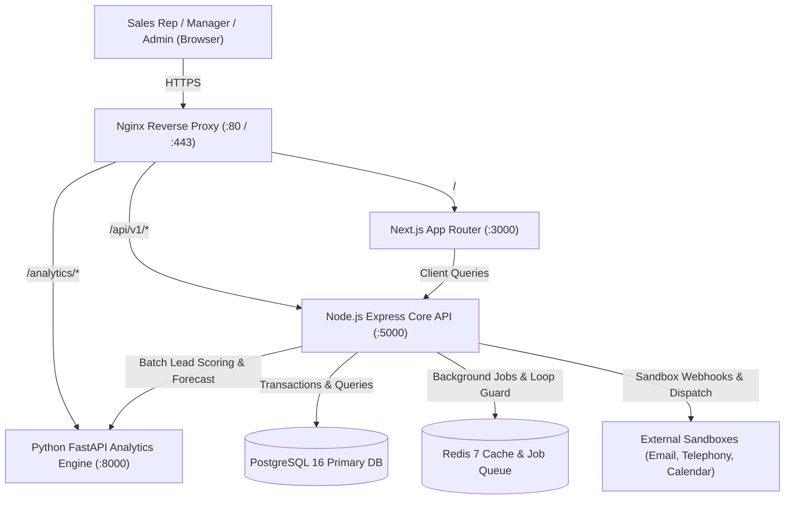
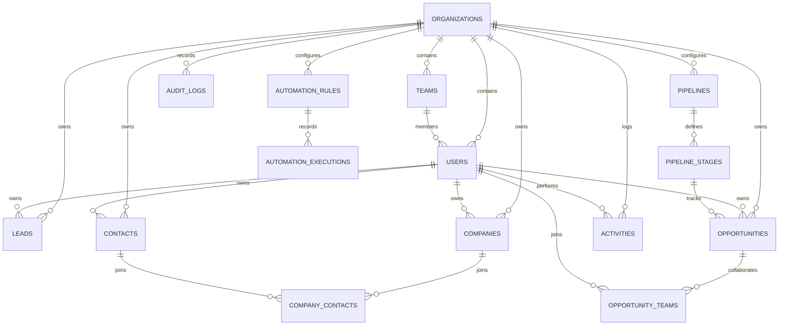

# ClientSphere Enterprise Architecture & System Design

## 1. System Overview
ClientSphere is a multi-tenant enterprise CRM, sales pipeline, and workflow automation platform. It is engineered with a modular multi-service architecture:
- **Client (Frontend)**: Next.js 14 App Router, TypeScript, Tailwind CSS, TanStack React Query.
- **Server (Core Business API)**: Node.js, Express.js REST APIs, PostgreSQL system of record, optimistic concurrency control, role-based access control (RBAC), and workflow automation engine.
- **Analytics Service (Intelligence)**: Python 3 FastAPI microservice handling CSV lead normalization, multi-factor fuzzy deduplication (Levenshtein distance), explainable lead scoring, sales velocity modeling, and 3-tier sales forecasting.
- **Caching & Async Messaging**: Redis & BullMQ job processing with loop protection and retry policies.
- **Reverse Proxy & Edge**: Nginx with SSL/TLS termination, rate limiting, and security headers.

---

## 2. Service & Dataflow Architecture

---

## 3. Database Entity-Relationship Diagram (ERD)

---

## 4. Key Architectural Decisions & Trade-Offs

### 4.1 Modular Multi-Service Boundary
- **Decision**: Express owns authoritative customer records (Leads, Contacts, Companies, Opportunities), transactions, and security checks. FastAPI owns heavy mathematical/analytical operations (Levenshtein fuzzy matching, statistical sales velocity, matrix calculations).
- **Justification**: Express handles I/O-intensive REST operations with low latency, while Python's scientific ecosystem excels at fuzzy string comparison, scoring heuristics, and predictive analytics.

### 4.2 Optimistic Concurrency Control (OCC)
- **Decision**: All `opportunities` table records carry an integer `version` column. Every `PUT` request must supply the current version. If the submitted version differs from the persisted version, the API rejects the update with `409 Conflict` (`CONCURRENT_MODIFICATION_ERROR`).
- **Justification**: In high-velocity sales teams where multiple representatives or automation workers update deals concurrently, pessimistic row locking creates database contention and deadlocks. OCC guarantees zero lost updates without locking transactions.

### 4.3 Many-to-Many Contacts & Companies with Role Titles
- **Decision**: Contacts are linked to Companies via the join table `company_contacts`, which includes `role_title`, `is_primary`, `start_date`, and `end_date`.
- **Justification**: In modern B2B SaaS, key executives (e.g., advisory CTOs, board members) frequently hold positions at multiple target accounts simultaneously. Modeling this as Many-to-Many prevents duplicate contact profiles while tracking account-specific titles.

### 4.4 Infinite Automation Loop Prevention
- **Decision**: All workflow automation executions track a `depth_level` counter. If a cascading rule chain exceeds depth 5, execution is immediately aborted with `ABORTED_LOOP` status.
- **Justification**: Prevents runaway automation loops (e.g. Lead Update -> Score Changed -> Trigger -> Lead Update) from exhausting CPU or flooding external webhooks.
